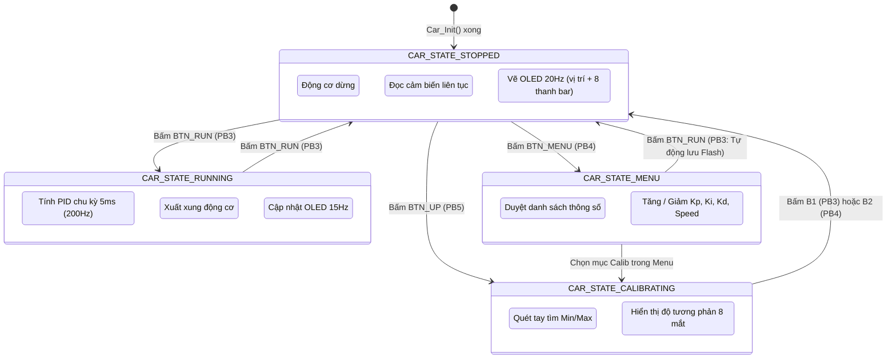

# 03. KIẾN TRÚC PHẦN MỀM VÀ MÁY TRẠNG THÁI (FSM)

## 1. Mô hình kiến trúc phân tầng (Layered Architecture)

Mã nguồn dự án được thiết kế theo cấu trúc phân tầng rõ rệt, đảm bảo tính đóng gói và dễ mở rộng:

```
+-----------------------------------------------------------+
|                   APPLICATION LAYER                       |
|           main.c  <--->  car_app.c / car_app.h            |
|       (Finite State Machine: STOP, RUN, CALIB, MENU)      |
+-----------------------------------------------------------+
                            |
+-----------------------------------------------------------+
|                   ALGORITHM LAYER                         |
|                     pid.c / pid.h                         |
|     (PID Computing, Anti-windup, Differential Drive)      |
+-----------------------------------------------------------+
                            |
+-----------------------------------------------------------+
|             HARDWARE DRIVER LAYER (HAL/DRIVERS)           |
|  qtr8a.c    tb6612.c    button.c    oled.c    delay.c     |
|  (ADC Read) (PWM/GPIO)  (Debounce)  (Display) (SysTick)   |
+-----------------------------------------------------------+
                            |
+-----------------------------------------------------------+
|               HARDWARE PERIPHERALS (STM32 SPL)            |
|       ADC1, TIM1, GPIOA/B, AFIO, SysTick, Flash           |
+-----------------------------------------------------------+
```

---

## 2. Máy trạng thái hữu hạn (Finite State Machine - FSM)

Toàn bộ logic hoạt động của xe nằm trong hàm `Car_Loop()` thuộc file [`car_app.c`](file:///c:/Users/Shall%20Wiron/Desktop/LINE_CAR/LINE_CAR/USER/car_app.c) với 4 trạng thái:



### Chi tiết các trạng thái:
1. **`CAR_STATE_STOPPED` (Màn hình chính thuần thông tin xe):**
   * Động cơ dừng hoàn toàn (`Motor_Stop()`).
   * Hiển thị vị trí vạch line, sai lệch tâm, tốc độ hiện tại, chế độ màu line và đồ thị 8 thanh quang trở soi line bên dưới.
   * `B1`: Chạy xe | `B2`: Mở Menu cài đặt.
2. **`CAR_STATE_RUNNING` (Đang chạy dò line):**
   * Vòng lặp điều khiển PID tần số cao **200 Hz (mỗi 5 ms)**.
   * Banner thể thao `= RUNNING =` đảo màu nền trắng chữ đen to rõ từ xa.
   * Thước đo độ lệch tâm line dạng đồ họa trực quan `[L] ────▲──── [R]`.
   * Nhấn **bất kỳ nút nào** để dừng khẩn cấp và ngắt động cơ ngay lập tức.
3. **`CAR_STATE_CALIBRATING` (Hiệu chuẩn cảm biến):**
   * Động cơ dừng, xóa dữ liệu Min/Max cũ.
   * Lấy mẫu liên tục qua DMA, ghi nhận giá trị sáng nhất và tối nhất của từng mắt quang trở.
   * Bấm `B1` hoặc `B2` để xác nhận xong $\rightarrow$ Tự động lưu vào Flash Page 63.
4. **`CAR_STATE_MENU` (Menu cài đặt tập trung):**
   * Dồn toàn bộ 7 mục cấu hình vào Menu: `Toc do`, `Kp`, `Kd`, `Line`, `Calib`, `Luu Flash`, `Thoat`.
   * `B4 (v)` di chuyển con trỏ | `B3 (+)` tăng | `B2 (-)` giảm (có auto-repeat) | `B1 (OK)` lưu Flash và thoát về màn hình chính.

---

## 3. Cơ chế thời gian thực không đồng bộ (Dual-Rate Timing)

Để đảm bảo thuật toán PID luôn được thực thi đúng chu kỳ chuẩn xác mà không bị hiện tượng giật cục (jitter) bởi việc vẽ màn hình OLED (vốn tốn nhiều thời gian truyền bus I2C), mã nguồn sử dụng cơ chế kiểm tra `millis()` không chặn:

```c
uint32_t now = millis();

/* Task 1: Quét nút bấm mỗi 10ms (100 Hz) */
Button_Update();

/* Task 2: Điều khiển PID mỗi 5ms (200 Hz) */
if (now - last_pid_tick >= 5) {
    last_pid_tick = now;
    s_line_pos = QTR8A_ReadLine(s_sensors, s_line_mode);
    s_pid_out = PID_Compute(&s_pid, s_line_pos, 3500);
    PID_CalculateMotorSpeeds(&s_pid, s_pid_out, &s_speed_left, &s_speed_right);
    Motor_SetSpeed(s_speed_left, s_speed_right);
}

/* Task 3: Cập nhật màn hình OLED mỗi 70ms (~14 Hz) khi đang chạy */
if (now - last_ui_tick >= 70) {
    last_ui_tick = now;
    UI_DrawRunning();
}
```

---

## 4. Tổng hợp API của các Module chức năng

### 4.1. Module PID ([`pid.h`](file:///c:/Users/Shall%20Wiron/Desktop/LINE_CAR/LINE_CAR/USER/pid.h))
* `void PID_Init(PID_Controller_t *pid, float kp, float ki, float kd, int16_t base, int16_t max, int16_t min)`: Khởi tạo bộ tham số và đặt ngưỡng tích phân `integral_limit = 10000.0f`.
* `void PID_Reset(PID_Controller_t *pid)`: Đặt lại `error`, `last_error` và `integral` về 0 khi xe bắt đầu chạy.
* `int16_t PID_Compute(PID_Controller_t *pid, int16_t current_pos, int16_t target_pos)`: Tính toán tín hiệu điều khiển ra (đầu ra trong dải $[-100, 100]$).
* `void PID_CalculateMotorSpeeds(...)`: Tính tốc độ PWM thực tế gán cho 2 bánh xe.

### 4.2. Module Cảm biến ([`qtr8a.h`](file:///c:/Users/Shall%20Wiron/Desktop/LINE_CAR/LINE_CAR/USER/qtr8a.h))
* `void QTR8A_Init(void)`: Cấu hình ADC1 kênh 0-7, xung nhịp 12MHz, hiệu chuẩn tự động ADC.
* `void QTR8A_Calibrate(void)`: Lấy mẫu cập nhật giá trị Min/Max cho từng mắt cảm biến.
* `void QTR8A_ResetCalibration(void)`: Khởi tạo lại dải đo về trạng thái ban đầu.
* `int16_t QTR8A_ReadLine(uint16_t *sensor_values, uint8_t line_mode)`: Đọc giá trị đã chuẩn hóa qua Calibrate, tính vị trí line từ 0 đến 7000 theo phương pháp trọng số.

### 4.3. Module Động cơ ([`tb6612.h`](file:///c:/Users/Shall%20Wiron/Desktop/LINE_CAR/LINE_CAR/USER/tb6612.h))
* `void Motor_Init(void)`: Khởi tạo GPIO và Timer 1 tạo PWM 1 kHz.
* `void Motor_SetSpeed(int16_t speedA, int16_t speedB)`: Xuất tốc độ bánh Trái và Phải (dải $-100 \dots +100$).
* `void Motor_Stop(void)`: Phanh trôi (Free run).
* `void Motor_Brake(void)`: Phanh hãm cứng (Short Brake).
* `void Motor_SetInvert(uint8_t invertA, uint8_t invertB)`: Đảo chiều quay logic của động cơ.

### 4.4. Module Nút bấm ([`button.h`](file:///c:/Users/Shall%20Wiron/Desktop/LINE_CAR/LINE_CAR/USER/button.h))
* `void Button_Init(void)`: Tắt JTAG, cấu hình PB3-PB6 IPU.
* `void Button_Update(void)`: Lấy mẫu lọc rung (Debounce) mỗi 10 ms.
* `uint8_t Button_WasPressed(Button_ID_t btn)`: Kiểm tra sự kiện bấm nhả (chỉ trả về 1 một lần).
* `uint8_t Button_WasLongPressed(Button_ID_t btn)`: Kiểm tra sự kiện giữ phím trên 800 ms.
