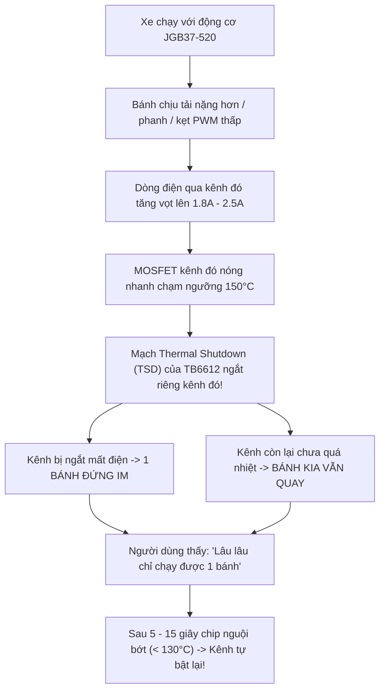

# 07. PHÂN TÍCH CHUYÊN SÂU ĐỘNG CƠ JGB37-520 VÀ CÁC TRƯỜNG HỢP VẬN HÀNH

> **Động cơ thực tế trên xe:** Cặp động cơ DC giảm tốc kim loại **JGB37-520** (Đường kính 37mm, cốt 6mm D-shaft, điện áp định mức 12V / 6V).  
> **Driver điều khiển:** Cầu H kép MOSFET **TB6612FNG** (Dòng liên tục 1.2A/kênh, đỉnh 3.2A).  
> **Vi điều khiển:** STM32F103C8T6 (72MHz, PWM 1 kHz Timer 1).  
> **Khối lượng xe ước tính:** 700g – 1.1kg (gấp 3–4 lần so với các dòng xe mini dùng động cơ N20 siêu nhẹ).

---

## 1. Đặc tính Kỹ thuật & Vật lý của Động cơ JGB37-520

Động cơ **JGB37-520** là dòng động cơ công nghiệp/robotics tải nặng phổ biến, sở hữu hộp số giảm tốc bằng thép nguyên khối (All-metal Spur Gearbox). So với các dòng động cơ đồ án cỡ nhỏ (N20, TT vàng), JGB37-520 mang lại lực kéo vượt trội nhưng kéo theo nhiều thách thức khắt khe về cơ khí và điện năng:

| Thông số kỹ thuật | Động cơ JGB37-520 (Thực tế) | Động cơ N20 / TT (Thông thường) | Tác động tới hệ thống xe dò line |
| :--- | :--- | :--- | :--- |
| **Đường kính thân** | **37 mm** (Vỏ kim loại dày) | 12 mm – 20 mm (Vỏ nhựa/nhỏ) | Trọng tâm xe dồn mạnh về trục bánh sau |
| **Khối lượng mỗi động cơ** | **150g – 180g** | 10g – 30g | Cặp motor chiếm ~350g, tổng xe nặng ~0.8–1kg |
| **Dòng không tải ($I_0$)** | **0.15A – 0.25A** | 0.05A – 0.08A | Tiêu thụ nguồn tĩnh lớn hơn |
| **Dòng có tải định mức** | **0.6A – 1.0A** | 0.15A – 0.3A | Nằm sát ngưỡng liên tục 1.2A của TB6612 |
| **Dòng kẹt (Stall Current)** | **1.5A – 2.5A** (đỉnh > 3.0A) | 0.6A – 0.9A | **VƯỢT ngưỡng bảo vệ của driver TB6612FNG** |
| **Mô-men xoắn (Torque)** | **2.5 – 12 kg·cm** (tùy ratio) | 0.2 – 0.8 kg·cm | Lực kéo cực khỏe, quay tại chỗ dứt khoát |
| **Quán tính quay rotor + hộp số** | **Rất lớn** (Flywheel effect) | Rất nhỏ | Độ trễ gia tốc/giảm tốc lớn, phanh khó dừng ngay |
| **Độ rơ cơ khí (Backlash)** | **2° – 5° góc quay** | < 1° | Trễ cơ học khi đổi chiều quay từ tiến sang lùi |
| **Vùng chết PWM (Deadband)** | **20% – 30% PWM** | 10% – 15% PWM | PWM thấp không đủ mô-men thắng ma sát tĩnh |

---

## 2. Phân tích Các Vấn đề Phần cứng Khi Phối Ghép JGB37-520

### 2.1. Nguy cơ Quá tải Nhiệt & Cháy Driver TB6612FNG (Cực kỳ quan trọng)
* **Thông số TB6612FNG:** Dòng tải định mức liên tục $I_{cont} = 1.2\text{A}$ mỗi kênh, dòng đỉnh ngắn hạn $I_{peak} = 3.2\text{A}$.
* **Thực tế với JGB37-520:**
  * Ở điều kiện chạy thẳng bằng phẳng, dòng tải dao động $0.5\text{A} - 0.8\text{A}$ $\rightarrow$ TB6612 hoạt động bình thường nhưng vỏ chip khá ấm.
  * Khi xe **ôm cua gấp, phanh hãm chủ động (`Motor_Brake()`)**, hoặc **quay ngược chiều ở góc vuông $90^\circ$** (`speed_left = -55, speed_right = +55`), dòng điện tức thời qua cuộn cảm vọt lên **$1.8\text{A} - 2.5\text{A}$/kênh**.
  * **Hậu quả:** Nếu chạy liên tục trên sân thi đấu có nhiều khúc cua:
    1. TB6612 sẽ kích hoạt cơ chế tự bảo vệ ngắt nhiệt (**Thermal Shutdown** ở $\sim 150^\circ\text{C}$): Xe bỗng nhiên bị khựng hoặc mất lực một bên bánh trong vài giây rồi chạy lại.
    2. Nếu không có tản nhiệt nhôm hoặc mạch in giải nhiệt kém, MOSFET nội của TB6612 có thể bị đánh thủng vĩnh viễn (chập kênh, bánh xe quay hết tốc độ không điều khiển được).

### 2.2. Hiện tượng Sụt áp Nguồn (Battery Voltage Sag) & Reset STM32
* Khi 2 động cơ JGB37-520 cùng tăng tốc hoặc đảo chiều gấp, tổng dòng tiêu thụ tức thời có thể chạm mốc **$3.5\text{A} - 5.0\text{A}$**.
* Dòng xả lớn qua nội trở pin LiPo ($R_{int}$) và các mối nối dây làm điện áp tổng bị sụt giảm tức thời:
  $$V_{battery\_sag} = V_0 - I_{surge} \times R_{total}$$
* **Hậu quả:**
  * Nếu mạch dùng chung một đường nguồn hạ áp 5V/3.3V mà không có diode Schottky và tụ lọc lớn: Điện áp cấp cho STM32 tụt xuống dưới $2.7\text{V}$, kích hoạt tính năng **Brown-Out Reset (BOR)**. Xe đang chạy bỗng khựng lại và khởi động lại từ đầu (hiện màn hình chào mừng OLED).
  * Màn hình OLED SSD1306 rất nhạy cảm với sụt áp 3.3V và xung nhiễu: Bus I2C dễ bị kẹt cờ `BUSY`, màn hình bị đơ, hiển thị rác hoặc tắt ngúm.

### 2.3. Quán tính Cơ khí Khổng lồ & Độ trễ Điều khiển
* Khối lượng xe trang bị JGB37-520 nặng xấp xỉ **$1\text{kg}$**. Động năng tịnh tiến $E_k = \frac{1}{2} m v^2$ và mô-men quán tính quay của xe gấp **5 đến 10 lần** xe tiêu chuẩn.
* **Thời gian đáp ứng cơ khí ($\tau_m$):** Động cơ JGB37 cần từ $50\text{ms} - 120\text{ms}$ để thay đổi tốc độ vòng quay theo xung PWM, trong khi vòng lặp PID chạy chu kỳ $5\text{ms}$ (200 Hz).
* Nếu dùng thông số PID quá gắt ($K_p$ cao), xe sẽ rơi vào tình trạng **quá điều khiển (Over-correction)**: Động cơ chưa kịp đáp ứng lệnh trước thì lệnh mới đã phát ra, gây hiện tượng dao động con lắc dữ dội.

### 2.4. Độ rơ Hộp số (Gearbox Backlash)
* Hộp số kim loại 37mm có nhiều tầng bánh răng spur. Khi bánh xe đảo chiều từ quay tiến sang quay lùi, trục ra mất một khoảng tự do khoảng $2^\circ - 5^\circ$ bánh răng mới ăn khớp lại chiều ngược.
* Điều này tạo ra một "vùng chết thời gian" khoảng $10\text{ms} - 20\text{ms}$ mỗi khi xe chuyển từ trạng thái chạy thẳng sang bẻ lái gắt.

### 2.5. HIỆN TƯỢNG ĐIỂN HÌNH: "LÂU LÂU XE CHỈ CHẠY ĐƯỢC 1 BÁNH" (GIẢI MÃ NGUYÊN NHÂN)

Hiện tượng xe đang chạy bình thường bỗng nhiên thỉnh thoảng chỉ có **1 bánh quay**, bánh còn lại đứng im (làm xe tự quay vòng tròn hoặc khựng lại rồi sau đó lại bình thường) xuất phát từ 3 mắt xích kỹ thuật sau:



#### 1. Nguyên nhân hàng đầu: Mạch ngắt nhiệt độc lập (Thermal Shutdown - TSD) của TB6612
* Bên trong IC TB6612FNG có 2 cầu H hoàn toàn độc lập (Kênh A cho Motor A, Kênh B cho Motor B).
* Mỗi kênh có cảm biến giám sát nhiệt độ silicon riêng. Khi một kênh phải gánh tải nặng hơn (ví dụ: bánh ngoài khi ôm cua, bánh bị phanh lùi, hoặc bánh bị kẹt hộp số), dòng điện qua kênh đó chạm $1.8\text{A} - 2.5\text{A}$.
* Nhiệt độ kênh đó nhanh chóng vượt ngưỡng **$150^\circ\text{C}$**. Mạch TSD của kênh đó **tự động cắt toàn bộ ngõ ra (đưa về High-Z, ngắt điện motor)** để chống nổ chip!
* Trong khi đó, kênh còn lại chịu dòng thấp hơn (chưa tới $150^\circ\text{C}$) vẫn tiếp tục phát xung chạy bình thường $\implies$ **Xe chỉ chạy đúng 1 bánh**.
* Sau khi dừng lại hoặc sau 5–15 giây, chip nguội xuống dưới $130^\circ\text{C}$ (độ trễ nhiệt Hysteresis), mạch TSD nhả ra và motor đó lại quay bình thường.

#### 2. Nguyên nhân phần mềm: Bánh trong rơi vào Vùng Chết PWM (Friction Deadband)
* Khi xe ôm cua, thuật toán vi sai tính: $V_{trong} = V_{base} - |u|$.
* Giả sử $V_{base} = 30$, $u = 20 \implies V_{trong} = 10\%$.
* Với động cơ JGB37-520 kéo xác xe nặng $1\text{kg}$, mức PWM $10\%$ là **KHÔNG ĐỦ MÔ-MEN** để thắng ma sát tĩnh của hộp số kim loại và lốp xe (Deadband của JGB37 là $\sim 20\% - 25\%$).
* Bánh trong bị **kẹt đứng im (Rotor Stall)** trong khi bánh ngoài ($V_{ngoài} = 50\%$) vẫn quay tít!
* Khi motor bị kẹt ở PWM thấp, không có phản điện động (Back-EMF = 0), cuộn dây biến thành điện trở thuần làm dòng điện tăng vọt, nung nóng chip TB6612 cực nhanh $\rightarrow$ kích hoạt tiếp Thermal Shutdown ở trên!

#### 3. Nguyên nhân cơ khí: Rung động làm lỏng ốc cọc đấu dây (Terminal) hoặc chổi than
* Động cơ JGB37-520 rung rất mạnh khi chạy. Các cọc bắt ốc vặn dây trên module TB6612 xanh hoặc các dây cắm breadboard dupont rất dễ bị lỏng.
* Một số động cơ JGB37 chổi than carbon khi dừng ở "điểm chết" tiếp xúc (dead spot) của cổ góp, nếu điện áp mồi ban đầu thấp sẽ không tự khởi động được cho đến khi có ngoại lực đẩy bánh xe.

---

### 2.6. Quy trình Chẩn đoán Nhanh Ngoài Sân (Test Guide)

Khi xe gặp hiện tượng "chỉ chạy 1 bánh", hãy thực hiện ngay 3 bước kiểm tra sau để xác định chính xác $100\%$ thủ phạm:

1. **Nhìn màn hình OLED:**
   * Dòng 1 màn hình RUNNING hiển thị: `SPEED  L:xxx  R:xxx`.
   * **Trường hợp A:** Màn hình hiện `L: 45  R: 45` (hoặc cả 2 bên đều $> 25$) mà thực tế chỉ có 1 bánh quay $\implies$ **Khẳng định 100% lỗi phần cứng (TB6612 ngắt nhiệt TSD hoặc lỏng cọc dây motor)**.
   * **Trường hợp B:** Màn hình hiện `L: 5   R: 65` $\implies$ Bánh trái rơi vào vùng chết PWM của giải thuật điều khiển.
2. **Sờ tay vào lưng chip TB6612FNG:**
   * Ngay khi thấy 1 bánh đứng im, ngắt công tắc nguồn và chạm nhẹ đầu ngón tay vào lưng chip TB6612:
   * Nếu chip **nóng rát tay ($>70^\circ\text{C} - 80^\circ\text{C}$)** $\implies$ Đã bị **Thermal Shutdown**! Cần dán tản nhiệt nhôm ngay lập tức.
3. **Dùng tay xoay thử bánh khi tắt nguồn:**
   * Xoay thử bánh trái và bánh phải bằng tay để cảm nhận lực cản hộp số:
   * Nếu một bên quay rất nặng còn bên kia quay trơn nhẹ $\implies$ Hộp số bị bó kẹt cơ khí hoặc có bánh răng bị sứt mẻ.

---

## 3. Phân tích Chi tiết Các Trường hợp Vận hành Trên Sân Đua

```
┌────────────────────────────────────────────────────────────────────────┐
│                      SƠ ĐỒ CÁC TÌNH HUỐNG TRÊN SÂN                      │
│                                                                        │
│   (1) Đoạn thẳng cao tốc       (2) Cua cong mượt      (3) Cua 90° gấp  │
│   ══════════════════════       ╭─────────────╮             │           │
│           │                    │             │             └───┐       │
│           ▼                    ▼             ▼                 │       │
│      Lệch cơ học          Lực ly tâm      Quán tính tiến   Góc vuông   │
│     Cần bù deadband      Dạt vạch mép    Cần phanh hãm    Xoay tại chỗ │
│                                                                        │
│   (4) Cua S liên tục           (5) Vạch đứt nét       (6) Vạch đích    │
│       ╭───╮                        │ │ │ │                 │           │
│       │   ╰───╮                    │ │ │ │               ──┴──         │
│   Dao động con lắc            Đà quán tính lớn        Phanh hãm cứng   │
│   Cần tăng Kd dập             Giữ thẳng 3500         Tránh trôi qua    │
└────────────────────────────────────────────────────────────────────────┘
```

### 3.1. Trường hợp 1: Chạy đường thẳng tốc độ cao (Straight Track)
* **Hành vi xe:** Xe tăng tốc dọc theo đường thẳng.
* **Vấn đề phát sinh:**
  * **Lệch cơ khí giữa 2 động cơ (Asymmetry):** Hai động cơ JGB37 không có Encoder phản hồi vòng kín (Closed-loop RPM). Do dung sai gia công và ma sát chổi than khác nhau, cùng một mức PWM $45\%$ nhưng một bánh có thể quay 210 RPM trong khi bánh kia chỉ quay 195 RPM.
  * Xe sẽ có xu hướng tự dạt sang một bên.
* **Biện pháp xử lý trong code:**
  * Khâu Tỉ lệ $P$ và Vi phân $D$ của PID liên tục bù đắp sai số lệch tâm ngay khi $e(t) \ne 0$.
  * Cần bổ sung ngưỡng bù sai số tĩnh nếu một bên động cơ luôn yếu hơn rõ rệt.

### 3.2. Trường hợp 2: Khúc cua cong thoải và dốc ($R > 25\text{cm}$)
* **Hành vi xe:** Vạch line uốn lượn liên tục với bán kính lớn.
* **Vấn đề phát sinh:**
  * Lực quán tính ly tâm $F_c = \frac{m v^2}{R}$. Xe nặng $1\text{kg}$ chịu lực ly tâm gấp 3 lần xe nhỏ.
  * Nếu lốp cao su có độ bám sân trung bình, xe sẽ bị trượt dạt (drift/skid) hướng ra mép ngoài của khúc cua, làm thanh cảm biến lệch hẳn khỏi vạch dù bánh trước vẫn đang bẻ lái.
* **Biện pháp xử lý:**
  * **Dynamic Corner Deceleration (Đã tích hợp trong `pid.c`):** Khi $|pid\_output| > 35$, tốc độ cơ sở `eff_base` tự động ghìm từ $45\%$ xuống còn $15\% - 25\%$, giảm căn bản động năng trước khi lực ly tâm kịp làm trượt bánh.

### 3.3. Trường hợp 3: Khúc cua vuông góc 90° (Sharp 90-Degree Corner)
* **Hành vi xe:** Xe đang chạy thì gặp vạch rẽ ngang vuông góc $90^\circ$.
* **Vấn đề phát sinh:**
  * Động năng tiến $E_k$ rất lớn khiến xe không thể rẽ vòng cung hẹp.
  * Nếu chỉ dùng vi sai thông thường ($V_L = 80, V_R = -30$), vận tốc tiến trung bình vẫn dương $+25\%$, quán tính sẽ đẩy cả xe vọt thẳng ra ngoài bãi trắng.
  * TB6612 chịu dòng xung hãm lớn khi chuyển trạng thái sang quay lùi bánh trong.
* **Biện pháp xử lý:**
  * **Máy trạng thái 3 pha (Đã tích hợp trong `car_app.c`):**
    1. **Pha Phanh (`CORNER_MANEUVER_BRAKE` - 15ms):** Gọi `Motor_Brake()` ngắt và nối tắt cuộn dây qua TB6612 để ghìm chết quán tính tịnh tiến.
    2. **Pha Quay tại chỗ (`CORNER_MANEUVER_PIVOT`):** Bánh trong quay lùi $-55\%$, bánh ngoài quay tiến $+55\%$. Do JGB37 có mô-men xoắn lớn, xe xoay quanh trục giữa cực kỳ dứt khoát.
    3. **Pha Thoát cua:** Sau khi xoay ít nhất $40\text{ms}$ và mắt giữa (mắt 3 hoặc 4) chạm lại vạch $\rightarrow$ xả tích phân $I$ (`PID_Reset`) để xe tiếp tục bám thẳng mượt mà, không giật lắc.

### 3.4. Trường hợp 4: Khúc cua liên tục hình chữ S (Chicane / S-Curves)
* **Hành vi xe:** Xe vừa bẻ hết lái sang trái thì ngay lập tức phải bẻ gắt sang phải.
* **Vấn đề phát sinh:**
  * **Hiệu ứng con lắc (Pendulum Effect):** Khối lượng 2 động cơ JGB37 đặt ở đuôi xe tạo thành cánh tay đòn quán tính quay (Yaw Inertia) rất lớn. Khi thân xe đang có đà xoay sang trái, việc bẻ lái sang phải gặp lực cản quán tính rất mạnh. Thân xe thường bị lắc lư qua lại 2-3 nhịp trước khi ổn định.
* **Biện pháp xử lý:**
  * Tăng trọng số khâu Vi phân $K_d$ trong Menu (từ $0.35$ lên $0.45 - 0.55$). Khâu $D$ đóng vai trò như chiếc giảm chấn thủy lực, triệt tiêu tốc độ đổi góc lái quá nhanh, dập tắt dao động lắc đuôi xe.

### 3.5. Trường hợp 5: Vạch đứt nét / Mất line ngắn (Dashed Lines & Gaps)
* **Hành vi xe:** Vạch line bị đứt quãng một đoạn $2\text{cm} - 10\text{cm}$.
* **Vấn đề phát sinh:**
  * Ở các code cũ, khi mất line xe lập tức bẻ lái cực đại ($0$ hoặc $7000$), khiến xe bị ngoặt gấp và văng ra khỏi đường đua.
* **Biện pháp xử lý (Đã tối ưu trong `qtr8a.c`):**
  * Nhờ khối lượng lớn của động cơ JGB37, xe có quán tính chuyển động thẳng rất ổn định.
  * Thuật toán phân loại: Nếu vạch line vừa biến mất ở vùng trung tâm ($2500 \le s\_last\_position \le 4500$), xe ép vị trí về **$3500$** (chạy thẳng), giúp xe "lướt" qua khe đứt nét nhẹ nhàng và bắt lại vạch ở phía bên kia.

### 3.6. Trường hợp 6: Vạch dừng đích (Crossline / Finish Line)
* **Hành vi xe:** Xe chạy về vạch đích (thường là vạch đen nằm ngang cắt ngang toàn bộ 8 mắt cảm biến).
* **Vấn đề phát sinh:**
  * Xe nặng $1\text{kg}$ nếu chỉ ngắt PWM (`Motor_Stop()`) thì xe sẽ tiếp tục trôi tự do (coast) thêm $15\text{cm} - 30\text{cm}$ do trớn của hộp số JGB37, dẫn tới chạy vượt quá vạch dừng quy định.
* **Biện pháp xử lý:**
  * Nhận diện vạch ngang qua hàm `QTR8A_IsCrossLine()` ($\ge 6$ mắt bắt vạch đồng thời).
  * Kích hoạt chế độ **Short Brake** (`Motor_Brake()`) để khóa cứng 2 bánh xe ngay lập tức trên vạch dừng.

---

## 4. Bảng Kiểm Tra & Đề Xuất Tối Ưu Cho Động Cơ JGB37-520

Để đảm bảo xe chạy bền bỉ, không bị cháy driver và đạt tốc độ tối ưu với động cơ JGB37-520, người dùng nên thực hiện các cải tiến sau:

```mermaid
graph TD
    subgraph Phần cứng (Hardware)
        H1["Dán tản nhiệt nhôm lên lưng IC TB6612FNG"]
        H2["Hàn tụ hóa 470uF - 1000uF sát chân VM của Driver"]
        H3["Hàn 3 tụ gốm 104 trên mỗi động cơ dập tia lửa điện chổi than"]
        H4["Dùng module Buck riêng cấp nguồn logic 5V/3.3V cách ly"]
    end
    subgraph Phần mềm (Software)
        S1["Tăng tần số PWM TIM1 từ 1kHz lên 8kHz - 10kHz"]
        S2["Tăng Kd lên 0.40 - 0.55 để dập tắt quán tính xe nặng"]
        S3["Giữ min_speed = -50% đến -60% cho pha quay tại chỗ"]
        S4["Bù vùng chết PWM Deadband ma sát hộp số"]
    end
```

### 4.1. Khuyến nghị Phần cứng sống còn (Hardware Checklist)
1. **Tản nhiệt cho TB6612:** Bắt buộc dán một miếng tản nhiệt nhôm nhỏ ($10\text{mm} \times 10\text{mm}$) kèm keo tản nhiệt lên lưng chip TB6612FNG.
2. **Tụ đệm nguồn động cơ:** Hàn trực tiếp 1 tụ hóa dung lượng lớn ($470\mu\text{F}$ đến $1000\mu\text{F}$ / 16V hoặc 25V) ngay tại chân `VM` và `GND` của module TB6612 để hấp thụ các xung gai áp ngược từ cuộn dây động cơ JGB37.
3. **Chống nhiễu chổi than động cơ:** Hàn 3 tụ gốm $104$ ($0.1\mu\text{F}$) trên từng động cơ: 1 tụ giữa 2 cực, 2 tụ từ mỗi cực hàn vào vỏ sắt của motor.
4. **Cách ly nguồn logic:** Đảm bảo nguồn cấp cho STM32 và OLED SSD1306 đi qua mạch hạ áp Buck (LM2596 / MP1584 / AMS1117) có diode chống ngược dòng từ động cơ đánh sang.

### 4.2. Khuyến nghị Cài đặt Thông số Menu OLED (Tuning Guidelines)
Dựa trên đặc tính cơ học của động cơ JGB37-520, các thông số PID tối ưu ngoài sân được khuyến nghị như sau:

| Thông số trên Menu OLED | Giá trị khuyến nghị cho JGB37-520 | Giải thích kỹ thuật |
| :--- | :---: | :--- |
| **1. Toc do (Base Speed)** | **$35\% - 45\%$** | Khối lượng lớn nên đặt tốc độ cơ sở vừa phải để đảm bảo an toàn vào cua |
| **2. Kp (Độ nhạy lái)** | **$0.035 - 0.045$** | Không đặt quá cao ($>0.060$) vì sẽ gây dao động giật cục do trễ cơ khí |
| **3. Kd (Dập tắt rung lắc)** | **$0.400 - 0.550$** | **Tăng mạnh** so với xe nhẹ để triệt tiêu hiệu ứng con lắc quán tính lớn |
| **4. Mau Line** | `Den` (hoặc `Trang`) | Tùy màu sân thi đấu |
| **5. Calib** | `[Start]` | Quét tay qua vạch ít nhất 3–4 lần trên sân thực tế |
| **6. Luu** | `[Flash]` | Lưu vĩnh viễn cấu hình vào Flash sau khi tinh chỉnh |

---
*Tài liệu được biên soạn phục vụ công tác phân tích, vận hành và tối ưu hóa hệ thống xe dò line tự hành STM32F103C8T6 sử dụng động cơ công suất tải nặng JGB37-520.*
